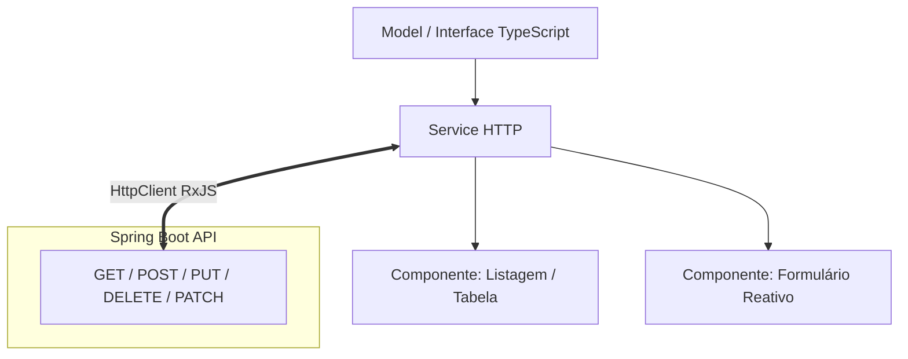
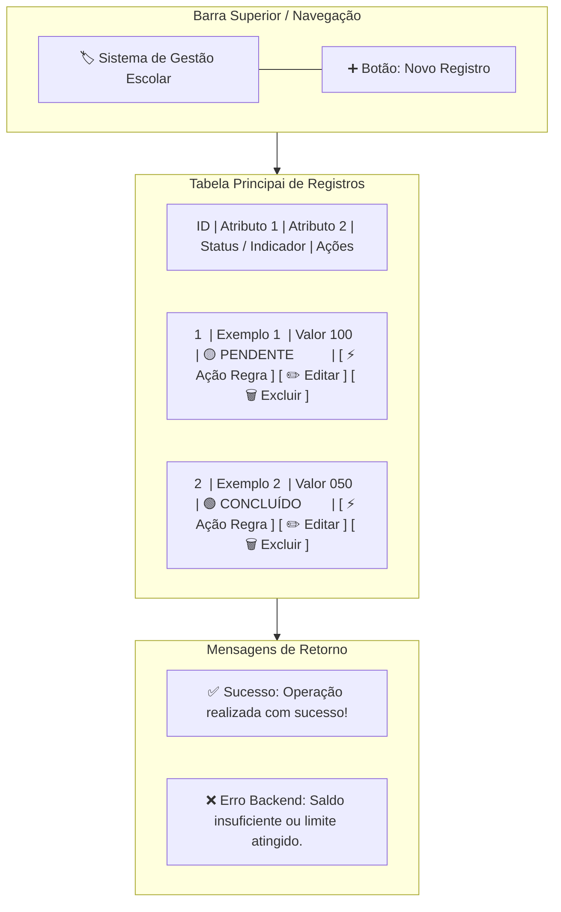
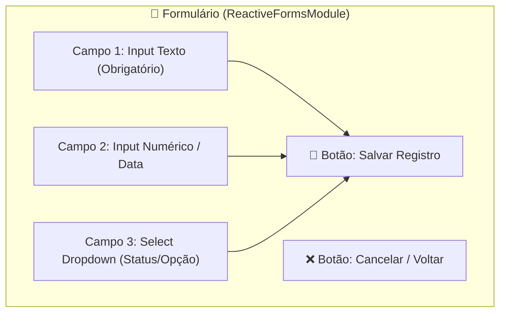

# Planejamento do Projeto Prático: Angular + Spring Boot

## 🅰️ Guia de Implementação no Angular

Esta seção descreve os requisitos de arquitetura, fluxo de dados e layout visual que todos os alunos devem seguir no desenvolvimento do frontend.

### 📐 Arquitetura Angular do Projeto

O frontend deve conter uma estrutura simples e organizada em **3 pilares principais**:

1. **Model (`/models`):** Interface TypeScript definindo os campos da entidade.
2. **Service (`/services`):** Classe `@Injectable` responsável por fazer requisições via `HttpClient`.
3. **Components (`/components`):** 
   * **Listagem:** Tabela ou grade de cards com as opções de ação e botões de editar/excluir.
   * **Formulário:** Tela ou modal para criar/editar os registros com `ReactiveFormsModule`.

---

### 🎨 Wireframe e Layout das Telas (Diagrama Visual)

Abaixo está o esboço em formato Mermaid descrevendo a experiência visual esperada para os projetos:

#### 1. Tela de Listagem (Dashboard)

#### 2. Tela de Formulário (Cadastro/Edição)

---

### 📋 Requisitos Detalhados para os Alunos (Exercício Angular)

Para considerar o módulo Angular **Aprovado**, o aluno deve implementar os seguintes requisitos:

1. **Interface TypeScript (`models/entidade.model.ts`):**
   * Deve possuir os mesmos nomes e tipos de atributos definidos na classe `@Entity` Java.

2. **Serviço HTTP (`services/entidade.service.ts`):**
   * Injetar o `HttpClient`.
   * Implementar os métodos:
     * `listar()`: realiza `GET` e retorna um `Observable<Entidade[]>`.
     * `buscarPorId(id)`: realiza `GET` individual.
     * `cadastrar(obj)`: realiza `POST`.
     * `atualizar(id, obj)`: realiza `PUT`.
     * `excluir(id)`: realiza `DELETE`.
     * `executarRegra(id, params)`: realiza o `POST`/`PATCH` específico da regra de negócio (ex: debitar, reservar, votar).

3. **Componente de Listagem (`components/listagem`):**
   * Chamar o serviço no ciclo de vida (`ngOnInit` ou `signals`).
   * Renderizar os dados dinamicamente (`*ngFor` ou novo bloco `@for`).
   * Adicionar destaque visual para status (ex: badges coloridas para `APROVADO`, `PENDENTE`, `LOTADO`).
   * Ter um botão dedicado para acionar a **Regra de Negócio** diretamente da linha/card do item.

4. **Componente de Formulário (`components/formulario`):**
   * Utilizar `FormGroup` e `FormBuilder`.
   * Adicionar validações (`Validators.required`, `Validators.min`, etc.) e exibir mensagem de erro abaixo do campo se estiver inválido.
   * Tratar reaproveitamento da tela tanto para **Inclusão** quanto para **Edição**.

5. **Tratamento de Exceções da Regra de Negócio:**
   * Se o backend lançar uma exceção (HTTP Status `400 Bad Request` ou `409 Conflict`), o serviço do Angular deve capturar e exibir uma mensagem amigável (ex: `alert()` ou mensagem na tela informando "Erro: Saldo insuficiente!").

---

